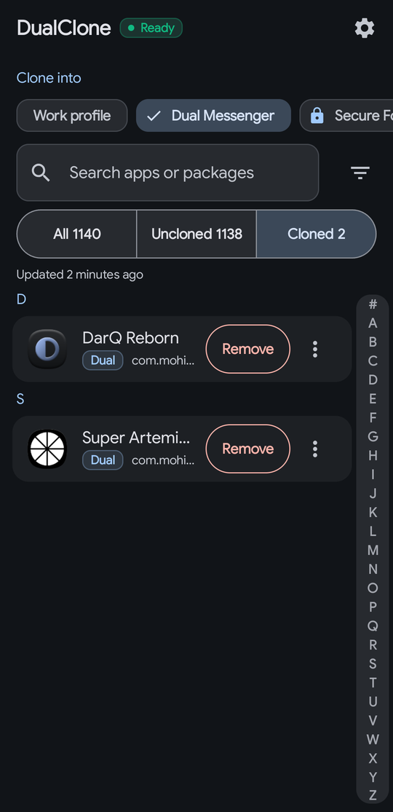
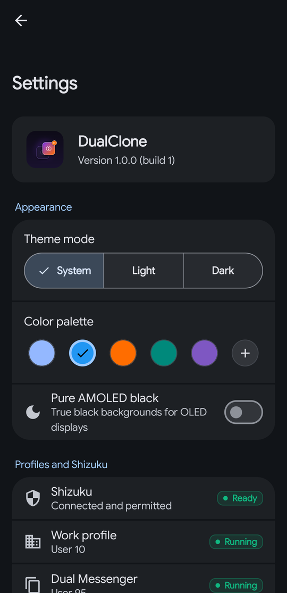
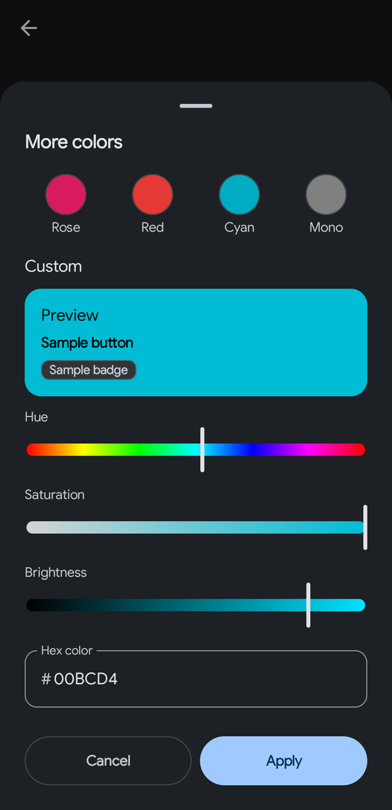

# DualClone

Clone any installed app into Samsung Dual Messenger or a work profile with one tap. No root. The only network use is the update check.

[](https://github.com/Arora-Sir/DualClone/releases/latest)
[](LICENSE)
[](https://developer.android.com)
[](https://shizuku.rikka.app)
[](#privacy)

[Download the latest APK](https://github.com/Arora-Sir/DualClone/releases/latest) | [Subscribe in Obtainium](https://apps.obtainium.imranr.dev/redirect?r=obtainium://app/%7B%22id%22%3A%22com.mohitarora.dualclone%22%2C%22url%22%3A%22https%3A%2F%2Fgithub.com%2FArora-Sir%2FDualClone%22%2C%22author%22%3A%22Arora-Sir%22%2C%22name%22%3A%22DualClone%22%7D) | [Report an issue](https://github.com/Arora-Sir/DualClone/issues/new/choose)

<!-- Screenshots use demo data only. See docs/screenshots/README.md for how to capture them. -->
<p>
  
  
  
</p>

## What it does

Samsung One UI only lets you enable Dual Messenger for a short list of messaging apps. Underneath, Dual Messenger is an Android user profile (User 95), and Android can install any app into a secondary profile with `pm install-existing`. DualClone lists every app on the device and runs that command for you through [Shizuku](https://shizuku.rikka.app).

* Clone and remove apps in Dual Messenger, a work profile (for example one created by Island) or another managed profile.
* Removal is verified. After `pm uninstall` the app checks the package manager again before it reports success, and it asks for confirmation first because removing a clone deletes that clone's data.
* Search, sort, and filter by All, Uncloned and Cloned. Bulk clone and remove with a per-app result list.
* Special Access (AppOps) controls for a clone, such as All Files Access and Display over other apps.
* Paused work profiles are detected and flagged before any operation.
* DualClone never clones itself.
* System apps and a profile owner such as Island are never listed as clones, and DualClone refuses to remove a profile owner.
* Clones without a host app (orphans) are listed and can be removed.
* Back up and restore your clone list, AppOps presets and settings to a file, or only the parts you choose, with an optional password. A restore shows a preview first and ends with a result for each item. See limits below.
* Material You theming with presets, a custom color and a pure black option.
* A local command log shows exactly which `pm` and `appops` commands ran.

## Requirements

1. Android 9 or newer.
2. [Shizuku](https://shizuku.rikka.app) running on the device.
3. A secondary profile to clone into. On Samsung, enable Dual Messenger once for any app under Settings, Advanced features, Dual Messenger. For a work profile, create one with Island or another work profile manager.

## Device support

| Device | Dual Messenger (User 95) | Work profile | Notes |
| :--- | :--- | :--- | :--- |
| Samsung Galaxy phones on One UI | Supported | Supported | Developed and tested on Galaxy S24 Ultra |
| Samsung Galaxy tablets on One UI | Supported | Supported | Developed and tested on Galaxy Tab S10 Ultra |
| Other Android devices | Not available | Expected to work | Needs a managed profile. Covered by the emulator test suite, not tested on specific hardware |
| Samsung Secure Folder (User 150) | Not supported | Not applicable | Knox blocks shell access to it. DualClone shows guidance and opens Secure Folder instead |

## Install

1. Download `DualClone-vX.Y.Z.apk` from [Releases](https://github.com/Arora-Sir/DualClone/releases/latest), or subscribe with Obtainium. Later updates can also come from inside the app, under Settings, Check for updates.
2. Check the signing certificate. The release APK is signed with this SHA-256 fingerprint:

```text
SHA-256: ce587f8d2e080c114cd3c3467a3fd2a85901e03b0e8eb23b400198559c1d54fc
```

   The same fingerprint is in the notes of every release. A different fingerprint means the APK was not built by this project.
3. `SHA256SUMS.txt` on the release holds the checksum of the APK.

To read the fingerprint of an APK yourself:

```bash
apksigner verify --print-certs DualClone-vX.Y.Z.apk
```

## Set up Shizuku

1. Install Shizuku from its [releases page](https://github.com/RikkaApps/Shizuku/releases) or from Google Play.
2. Start it. On Android 11 or newer, enable Developer options and Wireless debugging, then follow the pairing steps in the Shizuku app. On older versions, start it from a computer with adb.
3. Open DualClone and allow the Shizuku permission when prompted. If the prompt does not appear, open Shizuku, go to Authorized applications and enable DualClone.

Shizuku stops when the device reboots unless you use a start-on-boot option. The status badge on the Home screen shows whether Shizuku is ready.

## Use it

1. Pick the target profile at the top of Home.
2. Find an app and tap Clone. The button changes when the clone is verified.
3. Open the three dots on a clone for Special Access.
4. To remove a clone, tap Remove and confirm. The original app in your main profile is not touched.

After removing a clone, Samsung One UI Home sometimes keeps the old icon in the Work tab. DualClone shows a banner after a removal. Use Refresh launcher under Settings, Data to force it to redraw, or switch on the automatic refresh there.

## Limits

* Only the clone is created or removed. DualClone cannot copy app data between profiles, and backups cover your clone list and AppOps presets only. Reading another profile's app data needs root, which shell access does not provide.
* Android blocks some removals through device policy. DualClone shows the reason instead of a raw error.
* Shizuku has to be running for every clone, remove and AppOps operation. Browsing the catalog works without it.
* Play Store distribution is not possible. DualClone depends on Shizuku and on listing every installed app (`QUERY_ALL_PACKAGES`), which Google Play policy does not allow for this kind of tool. Releases go to GitHub only.
* English only. Hindi is not shipped yet.

## FAQ

**Why does DualClone need Shizuku?** Installing an existing app into another profile is a privileged `pm` call. Shizuku lets an app run it as the shell user without root.

**Is it safe?** The only network use is checking for and downloading updates. Nothing else leaves the device. Every shell argument is validated before it runs, and the log of what ran is on your device.

**Why does a cloned app ask me to sign in again?** A clone has separate app data, as Dual Messenger intends.

**An icon stayed in the Work tab after I removed a clone.** The package manager state is already clean. Use Refresh launcher under Settings, Data.

**Will updates replace my install?** Yes, as long as the certificate fingerprint matches. Obtainium and the Android installer both enforce that.

**Where do I ask questions?** [GitHub Discussions](https://github.com/Arora-Sir/DualClone/discussions). Bugs go to [Issues](https://github.com/Arora-Sir/DualClone/issues/new/choose).

## Privacy

DualClone uses the internet for one thing, the update check and download. The check runs when you tap Check for updates, or once a day if you switch that on in Settings (off by default). It asks the GitHub Releases API for the latest version, and the app downloads the signed APK and verifies its SHA-256 before the system installer opens. No analytics, no identifiers and no list of your apps are sent. Everything else stays on the device. Details and the reason for every permission are in [PRIVACY.md](PRIVACY.md).

## Build from source

See [SETUP.md](SETUP.md). Contributions are welcome, read [CONTRIBUTING.md](CONTRIBUTING.md) first. Security reports go through [SECURITY.md](SECURITY.md).

## Documentation

* [ARCHITECTURE.md](ARCHITECTURE.md) explains the layers and the Shizuku command path.
* [CONTEXT.md](CONTEXT.md) explains the Samsung multi-user background.
* [SETUP.md](SETUP.md) covers building and device testing.
* [docs/RELEASING.md](docs/RELEASING.md) covers signing and releasing, and [docs/UPDATES.md](docs/UPDATES.md) covers how users get updates.
* [CHANGELOG.md](CHANGELOG.md) lists changes.

## Credits

* [Shizuku](https://github.com/RikkaApps/Shizuku) by Rikka for privileged binder access without root.
* [thedjchi/Shizuku](https://github.com/thedjchi/Shizuku), a Shizuku fork with start-on-boot support.
* [Island](https://github.com/oasisfeng/island) by Oasis Feng for work profile research.
* [Dual-Manager](https://github.com/trunone/dual-manager) by trunone for Samsung Dual Messenger package management patterns.
* [DarQ-Reborn](https://github.com/Arora-Sir/DarQ-Reborn) for the theming and AppOps approach.
* [Material Color Utilities](https://github.com/jordond/materialkolor) by Google, ported to Kotlin by Jordon de Hoog, for generating accent palettes from a seed color (Apache License 2.0).
* Jetpack Compose, Room, Hilt, WorkManager and Coil from the Android and open-source communities. Licenses are listed in the app under Settings.

## License

Copyright (c) 2026 Mohit Arora. DualClone is free software under the GNU General Public License v3.0, see [LICENSE](LICENSE). It comes without any warranty.
